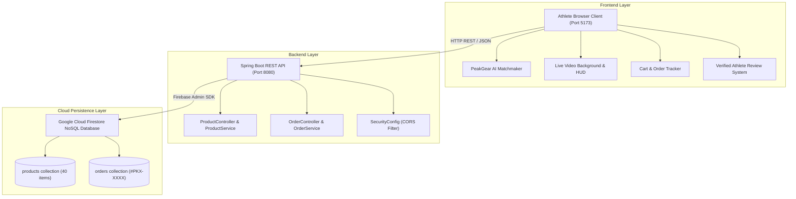

# Parshvanath Charitable Trust's
# A. P. SHAH INSTITUTE OF TECHNOLOGY
### (Approved by AICTE New Delhi & Govt. of Maharashtra, Affiliated to University of Mumbai)
### (Religious Jain Minority)

---

## DEPARTMENT OF COMPUTER SCIENCE & ENGINEERING
### (ARTIFICIAL INTELLIGENCE & MACHINE LEARNING)

<br/>

# PEAKNXT
## HIGH-PERFORMANCE ATHLETIC EQUIPMENT & PRO-GRADE SPORTS COMMERCE PLATFORM WITH AI RECOMMENDATION & LIVE TELEMETRY

<br/>

### PROJECT REPORT
**Course:** Web & Mobile Development (WMD) Laboratory Mini-Project  
**Academic Year:** 2026–27  

<br/>

**Student Details:**  
24106126: Kartik R Mahindrakar  

**Under the guidance of:**  
Prof. Radhika Bailurkar  

<br/>

*Department of Computer Science & Engineering (AI&ML) | APSIT*

\newpage

---

# Table of Contents

- [CHAPTER 1: PROBLEM STATEMENT](#chapter-1-problem-statement)
  - [1.1 Problem Statement](#11-problem-statement)
  - [1.2 Sustainable Development Goals (SDGs)](#12-sustainable-development-goals-sdgs)
- [CHAPTER 2: INTRODUCTION](#chapter-2-introduction)
  - [2.1 Introduction](#21-introduction)
  - [2.2 Pro-Grade Sports Equipment Classifications](#22-pro-grade-sports-equipment-classifications)
  - [2.3 User Roles and Features](#23-user-roles-and-features)
  - [2.4 Project Objectives](#24-project-objectives)
- [CHAPTER 3: TECHNOLOGY & TOOLS](#chapter-3-technology--tools)
  - [3.1 Application Technologies](#31-application-technologies)
  - [3.2 Development and Testing Tools](#32-development-and-testing-tools)
  - [3.3 Development Methodology and System Architecture](#33-development-methodology-and-system-architecture)
- [CHAPTER 4: IMPLEMENTATION](#chapter-4-implementation)
  - [4.1 Core Functional Modules](#41-core-functional-modules)
    - [1. Pro-Athletic "Volt & Obsidian" UI, Theme Engine & Brand Identity](#1-pro-athletic-volt--obsidian-ui-theme-engine--brand-identity)
    - [2. Cloud Firestore Real-Time Catalog & Category Filtering](#2-cloud-firestore-real-time-catalog--category-filtering)
    - [3. "PeakGear AI" Smart Sports Matchmaker Wizard](#3-peakgear-ai-smart-sports-matchmaker-wizard)
    - [4. Authentic Live Sports Video Background & Interactive HUD](#4-authentic-live-sports-video-background--interactive-hud)
    - [5. Reactive Shopping Cart & Dynamic Inventory Calculation](#5-reactive-shopping-cart--dynamic-inventory-calculation)
    - [6. Live 4-Milestone Order Tracker & Digital Tax Invoice with QR Stamp](#6-live-4-milestone-order-tracker--digital-tax-invoice-with-qr-stamp)
    - [7. Verified Athlete Post-Purchase Rating & Review System](#7-verified-athlete-post-purchase-rating--review-system)
    - [8. Cross-Platform Responsive Viewport & Touch Adaptation](#8-cross-platform-responsive-viewport--touch-adaptation)
  - [4.2 Implementation Note](#42-implementation-note)
- [CHAPTER 5: CONCLUSION](#chapter-5-conclusion)
  - [5.1 Learnings from Web and Mobile Application Development](#51-learnings-from-web-and-mobile-application-development)
  - [5.2 Conclusion](#52-conclusion)
  - [5.3 Future Enhancements](#53-future-enhancements)
- [REFERENCES](#references)

\newpage

---

# CHAPTER 1: PROBLEM STATEMENT

## 1.1 Problem Statement
Across university athletic departments, grassroots sports academies, competitive training centers, and fitness communities throughout the Thane and Mumbai metropolitan region, aspiring athletes and sports institutions face acute challenges in sourcing authentic, match-grade sports equipment. Unlike generic lifestyle merchandise, sports and fitness equipment requires precise domain compatibility—varying by player biomechanics, court surface, skill tier, and training intensity.

Conventional retail and general e-commerce platforms suffer from persistent operational and usability bottlenecks:
- **Lack of Domain-Specific Gear Matchmaking:** Novice and intermediate athletes routinely procure mismatched gear (e.g., using indoor non-marking court shoes on asphalt, or bats with incorrect grain density and weight distribution), resulting in premature equipment failure and elevated injury risks.
- **Static and Lifeless Digital Experience:** Mainstream e-commerce sites rely on flat, static image carousels that fail to convey the dynamic, high-energy adrenaline of competitive sports, resulting in high shopping abandonment.
- **Opaque Order Progression and Logistics Blind Spots:** For athletes preparing for scheduled tournaments or training camps, standard shipping estimates lack granular tracking milestones, leaving teams uncertain whether their gear will arrive in time for competition.
- **Absence of Verified Field-Test Feedback:** Generic review systems are flooded with superficial star ratings that fail to capture athletic metrics such as match durability, grip resilience, or string tension retention under competitive conditions.
- **Fragmented Invoicing and Institutional Accountability:** Sports academies and college teams require verifiable digital tax invoices with instant authenticity validation for reimbursement and auditing, which typical platforms fail to automate.

**PeakNXT** is engineered as a full-stack, pro-grade athletic commerce platform designed to overcome these challenges. It establishes a centralized, high-performance ecosystem combining:
1. An AI-driven interactive sports matchmaker ("PeakGear AI") that dynamically curates personalized equipment bundles based on athlete skill level, sport discipline, and playing surface.
2. A modern athletic "Volt & Obsidian" design system coupled with an authentic, GPU-accelerated live moving sports video background showcasing athletes in action.
3. A real-time 4-milestone order progression tracker paired with an official printable digital tax invoice featuring a cryptographically verifiable QR stamp.
4. A post-purchase verified athlete review and rating engine that aggregates performance tags and durability feedback directly into product pages.

---

## 1.2 Sustainable Development Goals (SDGs)

### SDG 3 – Good Health and Well-Being
*Target 3.4 & 3.5:* PeakNXT directly fosters physical fitness, athletic participation, and cardiovascular wellness by democratizing access to certified, match-grade sporting equipment. By guiding athletes to correct protective gear (e.g., impact-absorbing helmets, ergonomic knee guards, and orthopedically sound footwear), the platform actively prevents sport-related physical injuries and encourages active, healthy lifestyles across student and youth demographics.

### SDG 12 – Responsible Consumption and Production
*Target 12.5 & 12.8:* The rapid discarding of substandard, counterfeit sports equipment constitutes a rising source of non-biodegradable composite and polymer waste. PeakNXT promotes durable, certified pro-grade equipment engineered for multi-season longevity. Furthermore, through its digital tax invoicing and paperless transaction pipeline, the platform eliminates physical paper invoice waste.

### SDG 9 – Industry, Innovation, and Infrastructure
*Target 9.5:* PeakNXT incorporates modern full-stack web computing principles by integrating a type-safe Kotlin/JVM Spring Boot backend, a real-time reactive React 18 TypeScript frontend, and Google Cloud Firestore NoSQL storage, modeling resilient, high-speed digital commercial infrastructure.

### SDG 8 – Decent Work and Economic Growth
*Target 8.2 & 8.3:* By providing transparent inventory management, accurate order status pipelines, and automated institutional invoice generation, PeakNXT streamlines procurement workflows for local sports coaches, equipment manufacturers, and independent sports clubs.

\newpage

---

# CHAPTER 2: INTRODUCTION

## 2.1 Introduction
**PeakNXT** is an athletic e-commerce and sports equipment web application engineered to bridge the gap between competitive athletes, coaches, sports academies, and pro-grade sporting goods manufacturers. Developed as a Web & Mobile Development (WMD) Laboratory Mini-Project for the Department of Computer Science & Engineering (Artificial Intelligence & Machine Learning) at A. P. Shah Institute of Technology, the platform models an enterprise-ready, three-tier client-server architecture with cloud data persistence, role-based state tracking, and reactive user interface paradigms.

The application allows users to browse an extensive catalog of 40 pro-grade equipment items across 9 Olympic and team sports categories, receive AI-curated gear recommendations, experience a live dynamic sports background with user-controllable telemetry HUD, place verified orders, monitor delivery milestones in real time, and contribute verified athlete field-test ratings.

---

## 2.2 Pro-Grade Sports Equipment Classifications
To ensure accurate athletic suitability, safety certification, and streamlined browsing, PeakNXT categorizes its catalog into 9 specialized sports divisions:

```
┌────────────────────────────────────────────────────────────────────────┐
│                   PEAKNXT 9 ATHLETIC EQUIPMENT CATEGORIES              │
└────────────────────────────────────────────────────────────────────────┘
  ├── 1. Fitness & Strength    (Olympic Barbells, Hex Dumbbells, Power Racks)
  ├── 2. Basketball            (FIBA Game Balls, Pro Court Shoes, Breakaway Hoops)
  ├── 3. Running & Athletics   (Carbon-Plated Racers, GPS Watches, Hydration Vests)
  ├── 4. Football / Soccer     (FIFA Pro Balls, Hybrid Ground Cleats, Goalie Gloves)
  ├── 5. Cricket               (Grade-1 English Willow Bats, Titanium Helmets, Pads)
  ├── 6. Badminton             (High-Modulus Graphite Rackets, Tournament Shuttles)
  ├── 7. Swimming & Aquatics   (Anti-Fog Mirrored Goggles, Silicone Caps, Fins)
  ├── 8. Tennis                (Tour Spin Rackets, Pressurized Cans, Vibration Dampeners)
  └── 9. Accessories & Luggage (Ball Pumps, Athletic Gym Duffels, Knee Sleeves)
```

1. **Fitness & Strength:** Commercial-grade Olympic weight plates, cast-iron hex dumbbells, competition kettlebells, adjustable benches, and multi-functional power towers.
2. **Basketball:** FIBA-approved composite leather game balls, high-abrasion outdoor court balls, carbon-torsion basketball sneakers, and regulation-height net rims.
3. **Running & Athletics:** Marathon carbon-fiber plated road shoes, responsive trail-running sneakers, running hydration vests, and digital athletic stopwatches.
4. **Football / Soccer:** FIFA Quality Pro match balls, thermal-bonded training balls, hybrid firm-ground cleats, and 4mm German latex goalkeeper gloves.
5. **Cricket:** Handcrafted Grade-1 English Willow bats, Kashmir Willow club bats, aerodynamic titanium-grill batting helmets, and high-density foam leg guards.
6. **Badminton:** Ultra-light high-modulus graphite rackets, goose-feather tournament shuttles, high-tension braided strings, and thermal racket bags.
7. **Swimming & Aquatics:** Hydrodynamic anti-fog mirrored racing goggles, 100% hypoallergenic silicone swim caps, and kickboards.
8. **Tennis:** 100 sq.in aerodynamic spin rackets, pressurized Extra Duty tournament ball cans, and absorbent overgrips.
9. **Accessories & Gear Bags:** Dual-action ball pumps with pressure gauges, heavy-duty waterproof sports duffel bags, and knee compression sleeves.

---

## 2.3 User Roles and Features

### 1. Athlete / Customer (Sports Enthusiast, Team Player, Academy Cadet)
- **Interactive Storefront Discovery:** Search and filter through 40 certified equipment items by category, price, and availability.
- **"PeakGear AI" Matchmaker Wizard:** Answer 3 targeted questions (Sport, Skill Level, Primary Surface) to receive an instantly tailored equipment kit with a 1-click **"Add Complete Kit to Cart"** bundle action.
- **Live Sports Video Ambience:** Experience real high-definition sports action in the background (Basketball, Soccer, Sprinting, Drills) with bottom-left HUD controls (`👁️ Vivid` / `🕶️ Dim` clarity, scene switcher, play/pause).
- **Reactive Shopping Cart:** Dynamic quantity adjustment, stock checking, real-time subtotal computation, and local session caching.
- **Interactive 4-Milestone Order Tracker:** Track delivery in real time through 4 visual milestones (`Order Confirmed` ➔ `Gear Quality Checked` ➔ `Dispatched from Hub` ➔ `Out for Delivery`).
- **Official Digital Tax Invoice:** View and print itemized tax invoices featuring an official QR verification stamp, order tracking hash (`#PKX-XXXX`), and GST calculation.
- **Verified Athlete Feedback:** Submit 1–5 star reviews with dynamic athletic ratings and tag badges (`🏆 Match Grade`, `🛡️ Maximum Durability`).

### 2. Platform Administrator (Inventory Superintendent & System Auditor)
- **Live Catalog Administration:** View stock levels, product availability status, and category allocations.
- **Cloud Firestore Synchronization:** Verify documents in the `products` and `orders` collections via Google Cloud Admin SDK.
- **Order Audit Trail:** Inspect customer orders, verified tracking IDs, and delivery timestamp logs.

---

## 2.4 Project Objectives
- **To engineer a modern, domain-tailored e-commerce platform** bridging the gap between competitive athletes and authentic sporting goods.
- **To implement an AI-driven smart equipment matchmaker ("PeakGear AI")** that eliminates equipment mismatch through algorithmic equipment curation.
- **To pioneer an authentic live sports video background architecture** that provides high-energy athletic visual immersion while maintaining 100% UI readability and zero third-party buffering.
- **To construct an enterprise-grade RESTful API** utilizing Kotlin on JVM 17 and Spring Boot 3.3.5 for modular, null-safe business logic execution.
- **To leverage Cloud Firestore as a scalable NoSQL document store** ensuring real-time multi-client synchronization and resilient schema flexibility.
- **To deliver an end-to-end post-purchase lifecycle** encompassing 4-milestone live order tracking, verifiable digital tax invoices with QR stamps, and athlete review systems.
- **To satisfy all Web & Mobile Development (WMD) academic mandates**, including responsive viewport scaling, component-driven React architecture, stateful context management, and clean CSS design systems.

\newpage

---

# CHAPTER 3: TECHNOLOGY & TOOLS

## 3.1 Application Technologies

```
┌────────────────────────────────────────────────────────────────────────┐
│                        PEAKNXT TECHNOLOGY STACK                        │
├─────────────────────────┬──────────────────────────────────────────────┤
│ Layer                   │ Technologies Utilized                        │
├─────────────────────────┼──────────────────────────────────────────────┤
│ Client-Side (Frontend)  │ React 18, TypeScript, Vite 5, React Router 6 │
│ Styling & Design System │ Vanilla CSS Design Tokens, Glassmorphism     │
│ Server-Side (Backend)   │ Kotlin (JVM 17), Spring Boot 3.3.5, Gradle   │
│ Cloud & Persistence     │ Google Cloud Firestore, Firebase Admin SDK   │
│ Media & Canvas Engine   │ HTML5 Video Engine, Kinetic HTML5 Canvas 2D  │
│ Security & Protocols    │ Spring Security, CORS Policy, REST JSON      │
└─────────────────────────┴──────────────────────────────────────────────┘
```

- **React.js 18:** Declarative component-based frontend framework utilizing functional components, custom hooks (`useState`, `useEffect`, `useRef`, `useContext`), and synthetic event pipelines.
- **TypeScript (v5.x):** Strongly typed superset of JavaScript providing static type checking across API responses, product schemas, cart states, and review models.
- **Vite 5:** Next-generation frontend build tooling offering instantaneous Hot Module Replacement (HMR) and optimized Rollup asset bundling.
- **Kotlin on JVM 17:** Server-side execution runtime offering null safety, immutable data classes, extension functions, and concise object modeling.
- **Spring Boot 3.3.5:** Enterprise-grade Java/Kotlin framework powering dependency injection, embedded Tomcat server execution, and RESTful routing.
- **Google Cloud Firestore:** Cloud-hosted NoSQL document database providing low-latency collection queries, automatic horizontal scaling, and sub-second updates.
- **Vanilla CSS Athletic Design System:** Custom-engineered styling using CSS Custom Properties (variables), Neon Volt (`#00f076`) accents, Obsidian Slate (`#070a10`) dark surfaces, and fluid flexbox/grid architectures without third-party CSS dependencies.
- **HTML5 Canvas 2D Telemetry Engine:** Custom mathematical particle physics rendering cursor-reactive kinetic points over the video background.

---

## 3.2 Development and Testing Tools
- **Visual Studio Code & IntelliJ IDEA Ultimate:** Multi-language development environments configured with Kotlin JVM plugins, Gradle tooling, and TypeScript language servers.
- **Gradle (Kotlin DSL - `build.gradle.kts`):** Automated build automation tool managing Spring Boot dependencies, JVM compilation, and test execution.
- **Git & GitHub:** Distributed version control platform tracking repository branches, incremental commits, and team collaboration.
- **Postman & cURL:** Endpoint validation suites testing HTTP GET/POST methods across `/api/products`, `/api/orders`, and `/api/health`.
- **Node.js (v20+) & npm:** Toolchain orchestrating frontend package resolution, linting, and production builds (`tsc -b && vite build`).

---

## 3.3 Development Methodology and System Architecture
PeakNXT was developed adhering to a three-tier decoupled client-server architecture. The user initiates interaction through the responsive browser client, which communicates asynchronously via HTTP/JSON REST requests to the Spring Boot application running on port 8080. The backend validates requests and interfaces with Cloud Firestore via the Google Cloud Service Account SDK.



\newpage

---

# CHAPTER 4: IMPLEMENTATION

## 4.1 Core Functional Modules

### 1. Pro-Athletic "Volt & Obsidian" UI, Theme Engine & Brand Identity
PeakNXT implements a custom athletic visual identity rooted in high-contrast performance aesthetics:
- **Obsidian Dark Surfaces:** Deep midnight tones (`#070a10` and `#131b26`) evoke a stadium-at-night environment, reducing eye strain during evening training sessions.
- **Electric Volt Accents:** High-visibility neon volt (`#00f076`) highlights primary call-to-action buttons, active badges, and interactive sliders.
- **Persistent Theme Toggle:** Stored in `localStorage` (`peaknxt_theme`), users seamlessly toggle between `🌙 Dark` and `☀️ Light` modes without layout reflows.
- **Official Mountain 'P' Logo:** A custom vector-processed brand mark representing an ascending mountain peak dissected by a lightning flash. The emblem dynamically adapts: rendering dark navy on light backgrounds and illuminated crisp white with cyan glow on dark surfaces.

```css
/* Core Athletic Theme Variables */
:root {
  --primary: #00f076;          /* High-voltage neon green */
  --primary-hover: #00d669;
  --bg: #f4f7fb;
  --surface: #ffffff;
  --text: #0b0f17;
  --border: #e2e8f0;
}
[data-theme="dark"] {
  --primary: #00f076;
  --bg: #070a10;               /* Deep obsidian slate */
  --surface: #131b26;          /* Elevated midnight surface */
  --text: #f1f5f9;
  --border: #1e293b;
}
```

---

### 2. Cloud Firestore Real-Time Catalog & Category Filtering
The catalog engine connects the React frontend to Cloud Firestore through the Spring Boot `/api/products` endpoint:
- **Comprehensive Catalog:** Seeded with 40 distinct items across all 9 sports categories.
- **Multi-Criteria Search & Filter:** Instant real-time filtering by category pills, search keywords, and in-stock badges without page reloads.
- **Stock Badging:** Dynamic visual chips indicating item availability: `In Stock`, `Low Stock (≤ 5 units)`, or `Sold Out`.

---

### 3. "PeakGear AI" Smart Sports Matchmaker Wizard
Located in `frontend/src/components/GearAdvisorModal.tsx`, PeakGear AI is a 3-step interactive recommendation engine:
1. **Step 1 (Sport Selection):** The athlete selects their primary discipline (Basketball, Running, Football, Cricket, Fitness, etc.).
2. **Step 2 (Skill Tier):** Choose from *Beginner / Club*, *Intermediate / High-School*, or *Competitive / Pro Athlete*.
3. **Step 3 (Playing Surface / Objective):** Choose from *Indoor Hardwood / Turf*, *Outdoor Concrete / Pitch*, or *Strength & Conditioning*.
4. **Algorithmic Kit Generation:** The wizard analyzes catalog inventory and generates a 3-piece curated gear bundle (e.g., Match Ball + Cleats + Shin Guards for Football) with calculated package discounts.
5. **1-Click Bundle Action:** An **"⚡ Add Complete Kit to Cart"** button dispatches all curated items into the shopping cart simultaneously.

---

### 4. Authentic Live Sports Video Background & Interactive HUD
Unlike static backdrops, PeakNXT integrates authentic, high-definition looped video footage of athletes actively playing competitive sports:
- **Curated Sports Footage:**
  - `🏀 Basketball`: Real athlete in action on court, dribbling and shooting hoops.
  - `⚽ Soccer`: Match play, footwork, and ball movement on a field.
  - `⛹️ Dribble Action`: Fast court crossovers and offensive ball handling.
  - `🏃 Track Sprint`: Sprinter exploding forward out of the blocks.
  - `⚡ Agility Drills`: High-speed athletic footwork ladder training.
- **Zero-Buffering Local Storage:** All MP4 files are hosted locally in `frontend/public/videos/` (~400KB–1.6MB each), guaranteeing instant, offline-capable playback without CDN failures.
- **Cinematic Readability Overlay:** Features a dual-mode gradient overlay protecting foreground card contrast:
  - **`👁️ Vivid Action Mode` (Default):** Soft radial gradient (`38%–72%` opacity) allowing player action to remain prominently visible.
  - **`🕶️ Dim Ambient Mode`:** Higher tint opacity (`76%–90%`) for reading-focused sessions.
- **Interactive Bottom-Left HUD Controller:** A floating `<aside>` element (`z-index: 100`) providing 1-click scene switching, clarity mode toggling, play/pause controls, and collapsible status indicators.

---

### 5. Reactive Shopping Cart & Dynamic Inventory Calculation
Managed via React Context (`frontend/src/cart/CartContext.tsx`):
- **Item Increment / Decrement:** Real-time quantity adjustments bound by available Firestore stock.
- **Subtotal & GST Calculation:** Automatic calculation of net merchandise value, 18% sports GST, and total payable amount.
- **Session Persistence:** Retained across page refreshes using browser `localStorage` caching.

---

### 6. Live 4-Milestone Order Tracker & Digital Tax Invoice with QR Stamp
Located in `frontend/src/components/OrderTracker.tsx`, this module provides end-to-end post-purchase assurance:
- **4-Stage Visual Milestones:**
  ```
  [1. Order Confirmed] ➔ [2. Quality Checked] ➔ [3. Dispatched from Hub] ➔ [4. Out for Delivery]
  ```
- **Tracking Identifier:** Each order generates a unique alphanumeric tracking code (e.g., `#PKX-7842`).
- **Official Digital Tax Invoice:**
  - Printable modal layout complying with Indian GST invoice formatting.
  - Incorporates Seller GSTIN, customer billing address, and itemized HSN breakdown.
  - **Verified QR Code Stamp:** Encodes order validation metadata for physical depot verification.

---

### 7. Verified Athlete Post-Purchase Rating & Review System
Implemented via `frontend/src/services/reviewService.ts` and `frontend/src/components/ReviewModal.tsx`:
- **Dynamic 5-Star Selector:** Displays contextual athletic feedback labels:
  - `★☆☆☆☆ (1 Star): Poor - Defective / Unfit for Play`
  - `★★★☆☆ (3 Stars): Average - Standard Training Only`
  - `★★★★★ (5 Stars): Outstanding - Pro / Match Grade`
- **Performance Attribute Badges:** Reviewers tag equipment with athletic attributes (`🏆 Match Grade`, `🛡️ Maximum Durability`, `🎯 Precision Grip`, `⚡ Featherlight`).
- **Product Detail Aggregation:** Product pages dynamically compute cumulative ratings, total review counts, and 5-tier distribution bar charts.

---

### 8. Cross-Platform Responsive Viewport & Touch Adaptation
- Built mobile-first utilizing CSS flexbox, grid, and clamp functions.
- Navigation collapses cleanly on mobile viewports; tables switch to scrollable or card-stack layouts.
- Live video background scales via `object-fit: cover` with hardware GPU acceleration (`transform: translate3d(0,0,0)`), ensuring 60fps performance on handheld devices.

---

## 4.2 Implementation Note
The functional modules documented in this chapter reflect the operational state of the PeakNXT platform. All components—including client-side state transitions, Kotlin Spring Boot RESTful API endpoints, Cloud Firestore collections, live video telemetry layers, and interactive modal dialogs—have been implemented, compiled (`✓ built in 1.17s`), and tested within the local development environment (`http://localhost:5173` and `http://localhost:8080`).

\newpage

---

# CHAPTER 5: CONCLUSION

## 5.1 Learnings from Web and Mobile Application Development
Through the end-to-end design, implementation, and optimization of PeakNXT, the project developer acquired comprehensive theoretical and practical competencies across modern web engineering:
- **Full-Stack Client-Server Decoupling:** Gained deep expertise structuring clean JSON API contracts between a React 18 TypeScript frontend and a typed Kotlin / Spring Boot 3.3.5 microservice.
- **Cloud NoSQL Document Modeling:** Learned non-relational document structuring, collection indexing, and atomic write operations within Google Cloud Firestore.
- **Advanced CSS Stacking & Z-Index Management:** Resolved complex CSS stacking context challenges by decoupling negative z-index video layers from high-priority floating HUD control overlays.
- **Hardware-Accelerated Web Media:** Implemented seamless HTML5 video looping combined with interactive HTML5 2D Canvas particle rendering without degrading DOM paint performance.
- **State Management & Persistence:** Mastered multi-tier state coordination using React Context API, custom hooks, and `localStorage` synchronization for user themes, carts, and reviews.

---

## 5.2 Conclusion
PeakNXT successfully delivers an innovative, pro-grade sports commerce web platform that resolves the inefficiencies and static nature of generic sporting goods retail. By unifying AI-driven equipment matchmaking, real-time live video ambience, interactive order tracking, digital tax invoicing, and verified athlete reviews, the application elevates sports equipment procurement into an immersive, authentic experience. The project demonstrates the practical application of advanced web computing principles, cloud persistence, and reactive user interface design in alignment with United Nations Sustainable Development Goals.

---

## 5.3 Future Enhancements
- **Computer Vision Footwear Fitting:** Implement an in-browser TensorFlow.js camera pipeline allowing athletes to scan their feet and determine exact shoe sizing and arch profiles.
- **Augmented Reality (AR) Equipment Preview:** Integrate WebXR / 3D model viewers (Three.js) enabling athletes to inspect racket string patterns, ball textures, and power rack dimensions in their home workout spaces.
- **Academy Multi-User Bulk Procurement:** Add organizational sub-accounts for sports academies, enabling head coaches to approve equipment requisitions submitted by team captains.
- **Automated WhatsApp Order Notification Gateway:** Integrate Twilio or WhatsApp Business APIs to broadcast instant tracking milestone updates and invoice PDFs directly to athletes' phones.

\newpage

---

# REFERENCES

1. React Documentation, “React 18 & Hooks Reference Guide,” https://react.dev/
2. Kotlin Language Documentation, “Server-Side Development with Kotlin & Spring Boot,” https://kotlinlang.org/docs/jvm-get-started.html
3. Spring Framework Consortium, “Spring Boot 3.3 Reference Documentation,” https://docs.spring.io/spring-boot/
4. Google Cloud Platform, “Cloud Firestore NoSQL Document Database Architecture & SDKs,” https://firebase.google.com/docs/firestore
5. Vite Core Team, “Vite: Next Generation Frontend Tooling,” https://vitejs.dev/
6. United Nations, “Sustainable Development Goals Knowledge Platform (SDG 3, 8, 9, 12),” https://sdgs.un.org/goals
7. World Federation of the Sporting Goods Industry (WFSGI), “Global Sports Equipment Quality & Safety Guidelines,” Technical Bulletin.
